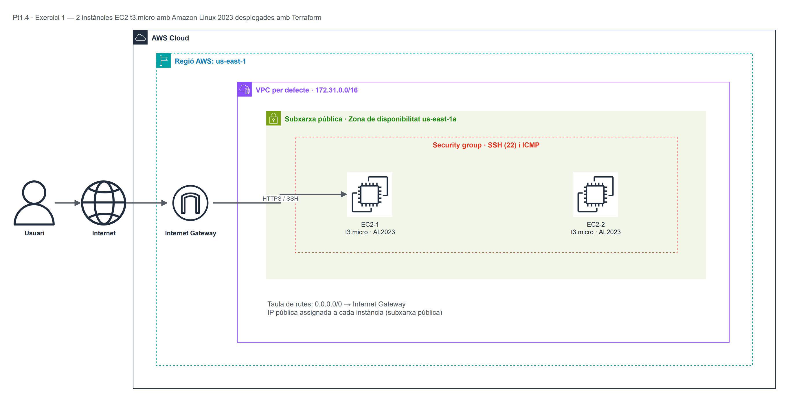

# Pt1.4 — Exercici 1: Primeres instàncies EC2 amb Terraform

Pràctica d'**Infraestructura com a Codi (IaC)** amb Terraform sobre AWS. L'objectiu és
desplegar de forma automatitzada **2 instàncies EC2 `t3.micro` amb Amazon Linux 2023**
a la regió **`us-east-1`**, sense tocar la consola d'AWS.

| Camp | Valor |
|---|---|
| Assignatura | Mòdul OPT: Cloud Computing (ASIX2) |
| Pràctica | Pt1.4 — Exercici 1 |
| Autor | Josué Córdova |
| Data | 26/10/2026 |
| Proveïdor | Amazon Web Services (AWS) |
| Regió | `us-east-1` (N. Virginia) |
| Eina IaC | Terraform >= 1.5 |

---

## 1. Objectiu

- Iniciar-se en Terraform com a eina d'Infraestructura com a Codi.
- Definir la infraestructura en un fitxer declaratiu (`main.tf`).
- Crear 2 instàncies EC2 amb les especificacions demanades per l'enunciat.
- Documentar el desplegament i la topologia de xarxa.

---

## 2. Arquitectura desplegada

Terraform crea els recursos següents dins de la **VPC per defecte** del compte
(`172.31.0.0/16`), a la zona de disponibilitat **`us-east-1a`**:

| Recurs | Nom / Valor | Detall |
|---|---|---|
| Instància EC2 1 | `practiquescloud-pt1-4-ex1-ec2-1` | `t3.micro`, Amazon Linux 2023, IP pública |
| Instància EC2 2 | `practiquescloud-pt1-4-ex1-ec2-2` | `t3.micro`, Amazon Linux 2023, IP pública |
| Security Group | `practiquescloud-pt1-4-ex1-sg` | Ingress TCP 22 (SSH), TCP 80 (HTTP) i ICMP; egress total |
| Subxarxa | Subxarxa per defecte de `us-east-1a` | Assignada automàticament pel compte |
| AMI | `al2023-ami-2023.*-x86_64` | Sempre la versió més recent publicada per Amazon |
| Regió | `us-east-1` | Definida a la variable `aws_region` |

Cada instància arrenca amb un `user_data` que instal·la i activa **Apache (httpd)** i
publica una pàgina HTML identificativa, de manera que es pot comprovar que la instància
és accessible per HTTP. Les dues instàncies comparteixen el mateix Security Group.

### Topologia de xarxa



> El diagrama s'ha fet amb **draw.io** (fitxer font: `assets/topologia.drawio`) i s'ha
> exportat a PNG. Els fluxos representats són: usuari → Internet → Internet Gateway →
> subxarxa pública `us-east-1a` → Security Group → instàncies EC2.

---

## 3. Estructura del repositori

```text
practiquescloud/
└── pt1-4-ex1/
    ├── assets/
    │   ├── topologia.drawio   # Font editable del diagrama (draw.io)
    │   └── topologia.png      # Diagrama exportat
    ├── main.tf                # Codi Terraform (variables, recursos i outputs)
    └── README.md              # Aquesta documentació
```

---

## 4. Requisits previs

1. **Terraform >= 1.5** instal·lat:

   ```bash
   terraform -version
   ```

2. **Credencials d'AWS** actives (en aquesta pràctica s'ha fet servir un compte
   d'AWS Academy Learner Lab). Les credencials es poden proporcionar de tres maneres:

   - Fitxer `~/.aws/credentials` amb `aws_access_key_id`, `aws_secret_access_key` i
     `aws_session_token`.
   - Variables d'entorn:

     ```bash
     export AWS_ACCESS_KEY_ID="..."
     export AWS_SECRET_ACCESS_KEY="..."
     export AWS_SESSION_TOKEN="..."
     export AWS_DEFAULT_REGION="us-east-1"
     ```

   - AWS CLI configurada (`aws configure`).

3. Permisos per crear instàncies EC2, Security Groups i llegir AMIs.

> **Important:** al Learner Lab, les credencials caduquen quan s'atura el laboratori.
> Si `terraform plan` retorna `ExpiredToken`, cal reiniciar el lab i actualitzar les
> credencials.

---

## 5. Procediment pas a pas

### Pas 1 — Clonar el repositori

```bash
git clone https://github.com/Josueinsti123/practiquescloud.git
cd practiquescloud/pt1-4-ex1
```

### Pas 2 — Inicialitzar Terraform

Descarrega el proveïdor d'AWS i prepara el directori de treball:

```bash
terraform init
```

### Pas 3 — Revisar el pla d'execució

Mostra què crearà Terraform **sense** desplegar res:

```bash
terraform plan
```

Al resum s'hi han de veure **2 recursos `aws_instance`** i **1 `aws_security_group`**
(`Plan: 3 to add, 0 to change, 0 to destroy`).

### Pas 4 — Desplegar la infraestructura

```bash
terraform apply
```

O bé, sense demanar confirmació:

```bash
terraform apply -auto-approve
```

En acabar, Terraform mostra els *outputs*:

```text
instance_ids = ["i-0123456789abcdef0", "i-0fedcba9876543210"]
public_ips   = ["54.x.x.x", "3.x.x.x"]
private_ips  = ["172.31.x.x", "172.31.x.x"]
```

### Resultat obtingut en aquest desplegament

| Recurs | ID | Tipus | AZ | IP privada | IP pública |
|---|---|---|---|---|---|
| `ec2-1` | `i-02269a6085132931a` | `t3.micro` | `us-east-1a` | `172.31.88.56` | `54.152.65.102` |
| `ec2-2` | `i-0717078af58b1e630` | `t3.micro` | `us-east-1a` | `172.31.87.37` | `98.94.40.192` |

AMI Amazon Linux 2023 utilitzada: `ami-04b938437b69a2c9c`.

Comprovació HTTP de les dues instàncies:

```text
$ curl http://54.152.65.102
<h1>Pt1.4 Exercici 1 - EC2 1 (t3.micro)</h1>

$ curl http://98.94.40.192
<h1>Pt1.4 Exercici 1 - EC2 2 (t3.micro)</h1>
```

### Pas 5 — Comprovar el desplegament

Amb l'AWS CLI:

```bash
aws ec2 describe-instances \
  --region us-east-1 \
  --filters "Name=tag:Project,Values=practiquescloud" \
  --query "Reservations[].Instances[].[InstanceId,InstanceType,State.Name,PublicIpAddress]" \
  --output table
```

També es pot comprovar des del navegador obrint `http://<IP_PUBLICA>` de cada
instància: hi apareix la pàgina "Pt1.4 Exercici 1 - EC2 1/2".

### Pas 6 — Connectar-se per SSH (opcional)

```bash
ssh -i ruta/a/la_clau.pem ec2-user@<IP_PUBLICA>
```

### Pas 7 — Destruir la infraestructura

Per no consumir crèdit del laboratori:

```bash
terraform destroy
```

---

## 6. Detall del codi (`main.tf`)

- **`terraform` block:** fixa la versió mínima de Terraform (`>= 1.5`) i la versió del
  proveïdor `hashicorp/aws` (`~> 5.0`).
- **`provider "aws"`:** regió parametritzada i `default_tags` comuns a tots els recursos
  (`Project`, `Practice`, `Exercise`, `ManagedBy`, `Environment`).
- **Variables:** `aws_region`, `project_name`, `instance_type`, `instance_count`,
  `availability_zone` i `ssh_cidr`. Cap valor crític queda escrit directament als
  recursos.
- **`data "aws_ami"`:** cerca la imatge més recent d'Amazon Linux 2023 (`x86_64`) en lloc
  de fer servir un AMI ID fix, que canvia segons la regió i el temps.
- **`data "aws_vpc"` / `data "aws_subnet"`:** utilitzen la VPC i la subxarxa per defecte
  del compte a `us-east-1a`; l'enunciat no demana crear una VPC pròpia en aquest exercici.
- **`aws_security_group`:** obre SSH (22), HTTP (80) i ICMP; l'origen es pot limitar amb
  la variable `ssh_cidr`.
- **`aws_instance`:** `count = 2`, `t3.micro`, AMI Amazon Linux 2023, `user_data` amb
  Apache i tags `Name` numerats (`ec2-1`, `ec2-2`).
- **`outputs`:** IDs, IPs públiques i privades, regió i AMI emprada.

### Canviar paràmetres sense editar el codi

Es pot sobreescriure qualsevol variable per línia de comandes. Per exemple, per crear 3
instàncies:

```bash
terraform apply -var="instance_count=3"
```

O limitar l'SSH a una IP concreta:

```bash
terraform apply -var="ssh_cidr=203.0.113.10/32"
```

---

## 7. Incidències i solucions

| Problema | Causa | Solució |
|---|---|---|
| `ExpiredToken` | Credencials del Learner Lab caducades | Reiniciar el lab i actualitzar `~/.aws/credentials` |
| `InvalidClientTokenId` | Credencials mal copiades | Tornar a generar-les i comprovar el `aws_session_token` |
| `VcpuLimitExceeded` | Límit de vCPUs del compte | Reduir `instance_count` o demanar augment de quota |
| `no matching EC2 Subnet found` | La regió no té subxarxa a `us-east-1a` | Canviar `availability_zone` |
| Error de versió del proveïdor | Versió d'AWS provider antiga | `terraform init -upgrade` |
| `InvalidParameterValue: Invalid security group description` | La descripció contenia un apòstrof (`'`), caràcter no permès per AWS | Escriure la descripció sense apòstrofs (`l exercici`) |
| La pàgina web no respon | El Security Group no obria el port 80 | Afegir l'ingress TCP 80 i tornar a fer `terraform apply` |

---

## 8. Neteja

```bash
terraform destroy -auto-approve
```

Comprovar que no queda cap instància en execució:

```bash
aws ec2 describe-instances \
  --filters "Name=instance-state-name,Values=running" \
  --query "Reservations[].Instances[].InstanceId" \
  --output text
```

---

## 9. Autor

**Josué Córdova** — ASIX2, INS Provençana
Mòdul OPT: Cloud Computing — Curs 2026-2027
