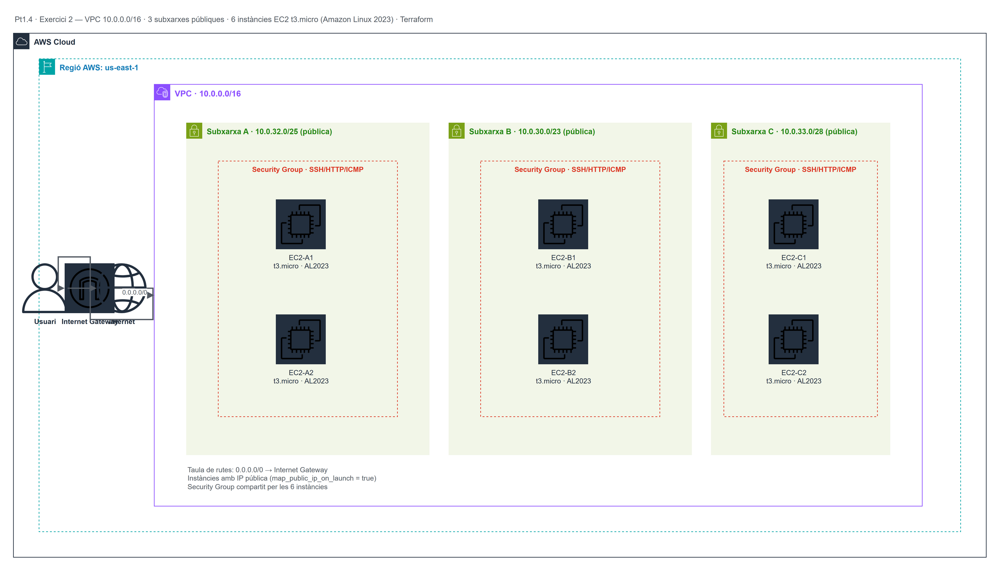

# Pt1.4 — Exercici 2: Disseny i desplegament de VPC, subxarxes i EC2

Pràctica d'**Infraestructura com a Codi (IaC)** amb Terraform sobre AWS. L'objectiu és
comprendre la segmentació de xarxes a AWS (VPC i subnets) i comparar el desplegament
manual (consola) amb el desplegament automatitzat amb Terraform.

| Camp | Valor |
|---|---|
| Assignatura | Mòdul OPT: Cloud Computing (ASIX2) |
| Pràctica | Pt1.4 — Exercici 2 |
| Autor | Josué Córdova |
| Data | 28/10/2026 |
| Proveïdor | Amazon Web Services (AWS) |
| Regió | `us-east-1` |
| Zona de disponibilitat | `us-east-1a` |
| Eina IaC | Terraform >= 1.5 |

---

## 1. Objectiu

- Comprendre la segmentació de xarxes a AWS (VPC i subxarxes).
- Comparar el desplegament manual (interfície gràfica) amb el desplegament
  automatitzat mitjançant Terraform.
- Crear una VPC personalitzada `10.0.0.0/16` amb 3 subxarxes i 6 instàncies EC2
  (2 per subxarxa).

---

## 2. Arquitectura desplegada

| Recurs | Nom | Detall |
|---|---|---|
| VPC | `practiquescloud-pt1-4-ex2-vpc` | CIDR `10.0.0.0/16`, DNS hostnames activats |
| Subxarxa A | `...-subnet-A` | `10.0.32.0/25` (128 adreces, 123 útils) |
| Subxarxa B | `...-subnet-B` | `10.0.30.0/23` (512 adreces, 507 útils) |
| Subxarxa C | `...-subnet-C` | `10.0.33.0/28` (16 adreces, 11 útils) |
| Internet Gateway | `...-igw` | Connectat a la VPC |
| Taula de rutes | `...-rt-public` | `0.0.0.0/0 → IGW`, associada a les 3 subxarxes |
| Security Group | `...-sg` | SSH (22), HTTP (80) i ICMP; egress total |
| Instàncies EC2 | 6 × `t3.micro` | Amazon Linux 2023, 2 per subxarxa, IP pública |

Les 3 subxarxes són **públiques** (`map_public_ip_on_launch = true`) i comparteixen la
mateixa Zona de Disponibilitat (`us-east-1a`), tal com demana l'enunciat. Les 6
instàncies comparteixen un únic Security Group.

### Topologia de xarxa



> Diagrama fet amb **draw.io** (font editable: `assets/topologia.drawio`).

### Captures de la consola d'AWS (Part B)

- VPC i subxarxes creades: `assets/vpc_subnets.png`
- Llistat de les 6 instàncies EC2 en execució: `assets/ec2_instances.png`

---

## 3. Estructura del repositori

```text
practiquescloud/
└── pt1-4-ex2/
    ├── assets/
    │   ├── topologia.drawio     # Font editable del diagrama (draw.io)
    │   ├── topologia.png        # Diagrama exportat
    │   ├── vpc_subnets.png     # Captura: VPC i subxarxes
    │   └── ec2_instances.png   # Captura: 6 instàncies EC2
    ├── main.tf                 # Codi Terraform (variables, recursos i outputs)
    └── README.md               # Aquesta documentació
```

---

## 4. Part A — Disseny de xarxa

Adreçament IP segons l'enunciat:

| Xarxa | CIDR | Adreces totals | Útils | AZ |
|---|---|---|---|---|
| VPC | `10.0.0.0/16` | 65536 | 65531 | — |
| Subxarxa A | `10.0.32.0/25` | 128 | 123 | `us-east-1a` |
| Subxarxa B | `10.0.30.0/23` | 512 | 507 | `us-east-1a` |
| Subxarxa C | `10.0.33.0/28` | 16 | 11 | `us-east-1a` |

Cap de les subxarxes se solapa: la B (`10.0.30.0/23`) ocupa `10.0.30.0–10.0.31.255`,
la A (`10.0.32.0/25`) ocupa `10.0.32.0–10.0.32.127` i la C (`10.0.33.0/28`) ocupa
`10.0.33.0–10.0.33.15`.

---

## 5. Part B — Desplegament per consola d'AWS (GUI)

1. Crear la VPC `10.0.0.0/16` amb DNS hostnames activats.
2. Crear les 3 subxarxes a `us-east-1a` amb els CIDR de la taula anterior i
   `Auto-assign public IPv4` activat.
3. Crear un Internet Gateway i associar-lo a la VPC.
4. Crear una taula de rutes amb `0.0.0.0/0 → IGW` i associar-la a les 3 subxarxes.
5. Crear un Security Group amb SSH (22), HTTP (80) i ICMP.
6. Llançar 2 instàncies `t3.micro` amb Amazon Linux 2023 a cada subxarxa (6 en total).
7. Fer captures de pantalla de la VPC, les subxarxes i el llistat final de les 6
   instàncies (guardades a `assets/vpc_subnets.png` i `assets/ec2_instances.png`).

---

## 6. Part C — Desplegament amb Terraform (IaC)

### Requisits previs

1. Terraform >= 1.5 instal·lat.
2. Credencials d'AWS actives (fitxer `~/.aws/credentials` o variables d'entorn).

### Procediment pas a pas

```bash
cd practiquescloud/pt1-4-ex2

# 1. Inicialitzar
terraform init

# 2. Revisar el pla (ha de mostrar: VPC + 3 subnets + IGW + route table +
#    3 associacions + SG + 6 instàncies = 16 recursos)
terraform plan

# 3. Desplegar
terraform apply -auto-approve

# 4. Verificar
aws ec2 describe-vpcs --filters "Name=tag:Project,Values=practiquescloud"
aws ec2 describe-subnets --filters "Name=vpc-id,Values=<VPC_ID>"
aws ec2 describe-instances --filters "Name=vpc-id,Values=<VPC_ID>"

# 5. Destruir quan s'acabi
terraform destroy -auto-approve
```

### Resultat obtingut en aquest desplegament

**VPC:** `vpc-08c11f3bccc56120b` (`10.0.0.0/16`, `us-east-1`)

| Subxarxa | ID | CIDR | AZ | IPs disponibles |
|---|---|---|---|---|
| A | `subnet-0b54e1de382797885` | `10.0.32.0/25` | `us-east-1a` | 121 |
| B | `subnet-09e90b11ce92016ca` | `10.0.30.0/23` | `us-east-1a` | 505 |
| C | `subnet-0fa8451a771761e4a` | `10.0.33.0/28` | `us-east-1a` | 9 |

**Internet Gateway:** `igw-02da920c12d7d8275` · **Taula de rutes:** `rtb-09fb5103a61852057`
(`0.0.0.0/0 → igw-02da920c12d7d8275`)

**6 instàncies EC2 en execució:**

| Nom | ID | Subxarxa | IP privada | IP pública |
|---|---|---|---|---|
| `...-A-ec2-1` | `i-095ceb529285018ca` | A | `10.0.32.63` | `3.87.200.205` |
| `...-A-ec2-2` | `i-00e770e574b089b76` | A | `10.0.32.16` | `13.223.57.239` |
| `...-B-ec2-1` | `i-02b3a633fbfe1e99b` | B | `10.0.30.156` | `3.82.114.217` |
| `...-B-ec2-2` | `i-08431e12307857f3c` | B | `10.0.30.80` | `54.152.54.66` |
| `...-C-ec2-1` | `i-012e38486c982934c` | C | `10.0.33.4` | `54.145.165.18` |
| `...-C-ec2-2` | `i-00c7536171e26264f` | C | `10.0.33.10` | `54.205.247.19` |

S'ha comprovat l'accés HTTP a les 6 màquines amb `curl`, obtenint la pàgina servida per
Apache a cadascuna (`Pt1.4 Ex2 - Subnet X - EC2 Y`).

---

## 7. Detall del codi (`main.tf`)

- **`terraform` block:** fixa la versió mínima de Terraform (`>= 1.5`) i la versió del
  proveïdor `hashicorp/aws` (`~> 5.0`).
- **`provider "aws"`:** regió parametritzada i `default_tags` comuns a tots els recursos.
- **Variables:** `aws_region`, `availability_zone`, `project_name`, `vpc_cidr`,
  `instance_type`, `instances_per_subnet`, `ssh_cidr` i `public_subnets` (mapa de les
  3 subxarxes amb el seu CIDR i AZ). Cap valor crític queda escrit directament als
  recursos.
- **`data "aws_ami"`:** cerca la imatge més recent d'Amazon Linux 2023 (`x86_64`).
- **`aws_vpc`:** crea la VPC `10.0.0.0/16` amb DNS support i hostnames activats.
- **`aws_subnet` (for_each):** crea les 3 subxarxes a partir del mapa `public_subnets`,
  amb `map_public_ip_on_launch = true`.
- **`aws_internet_gateway` + `aws_route_table` + `aws_route_table_association`:**
  connecten la VPC a Internet i associen la taula de rutes a les 3 subxarxes.
- **`aws_security_group`:** obre SSH (22), HTTP (80) i ICMP.
- **`locals` + `aws_instance` (for_each):** genera un mapa d'instàncies (2 per
  subxarxa = 6) a partir de `public_subnets` i `instances_per_subnet`, evitant
  duplicar codi.
- **`outputs`:** IDs de la VPC, subxarxes, instàncies, IPs públiques i un resum
  complet.

### Canviar paràmetres sense editar el codi

```bash
# Canviar el nombre d'instàncies per subxarxa
terraform apply -var="instances_per_subnet=3"

# Limitar l'SSH a una IP concreta
terraform apply -var="ssh_cidr=203.0.113.10/32"
```

---

## 8. Incidències i solucions

| Problema | Causa | Solució |
|---|---|---|
| `ExpiredToken` | Credencials del Learner Lab caducades | Reiniciar el lab i actualitzar `~/.aws/credentials` |
| `InvalidParameterValue: Invalid security group description` | La descripció contenia un apòstrof (`'`), caràcter no permès per AWS | Escriure la descripció sense apòstrofs |
| `VcpuLimitExceeded` | Límit de vCPUs del compte | Reduir `instances_per_subnet` o demanar augment de quota |
| Subxarxa sense IPs disponibles | CIDR massa petit (`/28` = 11 útils) | Planificar el nombre d'instàncies abans de crear-la |

---

## 9. Neteja

```bash
terraform destroy -auto-approve
```

Comprovar que no queda cap recurs en execució:

```bash
aws ec2 describe-instances \
  --filters "Name=vpc-id,Values=<VPC_ID>" "Name=instance-state-name,Values=running" \
  --query "Reservations[].Instances[].InstanceId" \
  --output text
```

---

## 10. Autor

**Josué Córdova** — ASIX2, INS Provençana
Mòdul OPT: Cloud Computing — Curs 2026-2027
