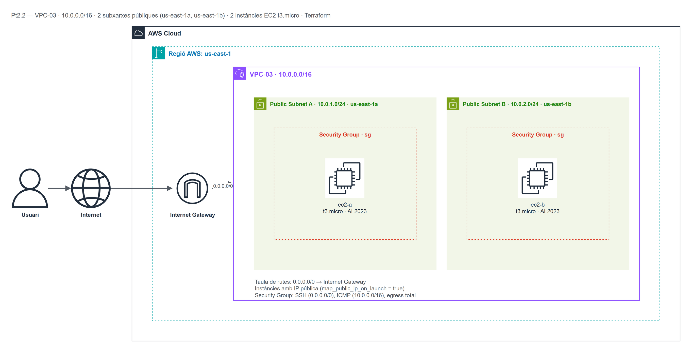

# Pt2.2 — Infraestructura bàsica a AWS amb Terraform

Pràctica d'**Infraestructura com a Codi (IaC)** amb Terraform sobre AWS. L'objectiu és
crear una VPC amb dues subxarxes públiques en zones de disponibilitat diferents, connectar-la
a Internet i desplegar-hi 2 instàncies EC2 amb el parell de claus `vockey`.

| Camp | Valor |
|---|---|
| Assignatura | Mòdul OPT: Cloud Computing (ASIX2) |
| Pràctica | Pt2.2 (A1 A2 RA1 RA2) |
| Autor | Josué Córdova |
| Data | 09/11/2026 |
| Proveïdor | Amazon Web Services (AWS) |
| Regió | `us-east-1` |
| Zones de disponibilitat | `us-east-1a` i `us-east-1b` |
| Eina IaC | Terraform >= 1.5 |

---

## 1. Objectiu

- Configurar el proveïdor d'AWS a la regió `us-east-1`.
- Crear una VPC anomenada `VPC-03` amb el bloc `10.0.0.0/16`.
- Crear 2 subxarxes públiques amb assignació automàtica d'IP pública:
  - `Public Subnet A` a `us-east-1a` amb `10.0.1.0/24`.
  - `Public Subnet B` a `us-east-1b` amb `10.0.2.0/24`.
- Crear un Internet Gateway i una taula de rutes pública (`0.0.0.0/0 → IGW`)
  associada a totes dues subxarxes.
- Crear un Security Group amb SSH (0.0.0.0/0), ICMP (només VPC) i egress total.
- Llançar 2 instàncies EC2 `t3.micro` amb Amazon Linux 2023, una a cada subxarxa,
  amb la clau `vockey` i etiquetades `ec2-a` i `ec2-b`.

---

## 2. Arquitectura desplegada

| Recurs | Nom | Detall |
|---|---|---|
| VPC | `VPC-03` | CIDR `10.0.0.0/16`, DNS hostnames activats |
| Subxarxa A | `Public Subnet A` | `10.0.1.0/24`, `us-east-1a`, IP pública automàtica |
| Subxarxa B | `Public Subnet B` | `10.0.2.0/24`, `us-east-1b`, IP pública automàtica |
| Internet Gateway | `igw` | Connectat a la VPC-03 |
| Taula de rutes | `rt-public` | `0.0.0.0/0 → IGW`, associada a A i B |
| Security Group | `sg` | SSH (22) des de 0.0.0.0/0; ICMP des de 10.0.0.0/16; egress total |
| Instància EC2 A | `ec2-a` | `t3.micro`, Amazon Linux 2023, clau `vockey`, subxarxa A |
| Instància EC2 B | `ec2-b` | `t3.micro`, Amazon Linux 2023, clau `vockey`, subxarxa B |

### Topologia de xarxa



> Diagrama fet amb **draw.io** (font editable: `assets/topologia.drawio`).

### Captures de la consola d'AWS (evidències del desplegament)

- VPC-03, subxarxes, Internet Gateway i taula de rutes: `assets/vpc_subnets.png`
- Security Group (regles SSH/ICMP/egress): `assets/security_group.png`
- 2 instàncies EC2 en execució (`ec2-a`, `ec2-b`): `assets/instances.png`

---

## 3. Estructura del repositori

```text
practiquescloud/
└── pt2-2/
    ├── assets/
    │   ├── topologia.drawio     # Font editable del diagrama (draw.io)
    │   └── topologia.png        # Diagrama exportat
    ├── main.tf                 # Codi Terraform (recursos i outputs)
    ├── variables.tf            # Variables (regió, CIDR, AZ, clau, ...)
    └── README.md               # Aquesta documentació
```

---

## 4. Disseny de xarxa

| Xarxa | CIDR | Adreces totals | Útils | AZ |
|---|---|---|---|---|
| VPC-03 | `10.0.0.0/16` | 65536 | 65531 | — |
| Public Subnet A | `10.0.1.0/24` | 256 | 251 | `us-east-1a` |
| Public Subnet B | `10.0.2.0/24` | 256 | 251 | `us-east-1b` |

Les dues subxarxes no se solapen i estan en zones de disponibilitat diferents.

---

## 5. Requisits previs

1. Terraform >= 1.5 instal·lat.
2. Credencials d'AWS actives (`~/.aws/credentials` o variables d'entorn).
3. El parell de claus `vockey` creat a AWS (a AWS Academy Learner Lab ja existeix).

---

## 6. Procediment pas a pas

```bash
cd practiquescloud/pt2-2

# 1. Inicialitzar
terraform init

# 2. Revisar el pla
terraform plan

# 3. Desplegar
terraform apply -auto-approve

# 4. Verificar
VPC=$(terraform output -raw vpc_id)
aws ec2 describe-vpcs --vpc-ids $VPC --output table
aws ec2 describe-subnets --filters "Name=vpc-id,Values=$VPC" --output table
aws ec2 describe-instances --filters "Name=vpc-id,Values=$VPC" --output table

# 5. Connectar per SSH (opcional)
ssh -i vockey.pem ec2-user@<IP_PUBLICA>

# 6. Destruir quan s'acabi
terraform destroy -auto-approve
```

---

## 6b. Resultat obtingut en aquest desplegament

**VPC:** `vpc-0786c597513863c5b` (`VPC-03`, `10.0.0.0/16`, `us-east-1`)

| Subxarxa | ID | CIDR | AZ | IP pública automàtica |
|---|---|---|---|---|
| Public Subnet A | `subnet-02c0c50492b2da08e` | `10.0.1.0/24` | `us-east-1a` | Sí |
| Public Subnet B | `subnet-0042aabf36c657dbb` | `10.0.2.0/24` | `us-east-1b` | Sí |

**Internet Gateway:** `igw-0eab44b1e882a026e` · **Taula de rutes:** `rtb-082d5a0ee0092ebe4`
(`0.0.0.0/0 → igw-0eab44b1e882a026e`)

**2 instàncies EC2 en execució:**

| Nom | ID | Tipus | AZ | Subxarxa | IP privada | IP pública | Clau |
|---|---|---|---|---|---|---|---|
| `ec2-a` | `i-0ee52afaa8dda73ee` | `t3.micro` | `us-east-1a` | A | `10.0.1.x` | `3.95.13.44` | `vockey` |
| `ec2-b` | `i-02d39d69a23972974` | `t3.micro` | `us-east-1b` | B | `10.0.2.x` | `3.85.93.172` | `vockey` |

El Security Group `sg` (`sg-03f767403ca5f4112`) té les regles ingress SSH (22) des de
`0.0.0.0/0` i ICMP des de `10.0.0.0/16`, i egress total.

## 7. Detall del codi (`main.tf` i `variables.tf`)

- **`terraform` block:** fixa la versió mínima de Terraform (`>= 1.5`) i la versió del
  proveïdor `hashicorp/aws` (`~> 5.0`).
- **`provider "aws"`:** regió parametritzada (`us-east-1`) i `default_tags` comuns.
- **`data "aws_ami"`:** cerca la imatge més recent d'Amazon Linux 2023 (`x86_64`).
- **`aws_vpc`:** crea la VPC `VPC-03` (`10.0.0.0/16`) amb DNS support i hostnames.
- **`aws_subnet` (2 recursos):** una per AZ, amb `map_public_ip_on_launch = true`.
- **`aws_internet_gateway` + `aws_route_table` + `aws_route_table_association` (×2):**
  connecten la VPC a Internet i associen la taula de rutes a totes dues subxarxes.
- **`aws_security_group`:** SSH (22) des de 0.0.0.0/0; ICMP des de 10.0.0.0/16;
  egress total (`0.0.0.0/0`).
- **`aws_instance` (×2):** `t3.micro`, Amazon Linux 2023, clau `vockey`, SG creat,
  etiquetes `ec2-a` i `ec2-b`, una a cada subxarxa.
- **`variables.tf`:** regió, projecte, CIDR de VPC i subxarxes, AZs, tipus d'instància
  i nom de la clau.
- **`outputs`:** IDs de VPC, subxarxes, instàncies i IPs públiques.

---

## 8. Incidències i solucions

| Problema | Causa | Solució |
|---|---|---|
| `ExpiredToken` | Credencials del Learner Lab caducades | Reiniciar el lab i actualitzar `~/.aws/credentials` |
| `InvalidKeyPair.NotFound` | La clau `vockey` no existeix a la regió | Crear el parell de claus o usar el nom correcte |
| `VcpuLimitExceeded` | Límit de vCPUs del compte | Reduir el nombre d'instàncies |
| ICMP no respon | El SG no permet ICMP des de la VPC | Afegir la regla ingress ICMP amb CIDR `10.0.0.0/16` |

---

## 9. Neteja

```bash
terraform destroy -auto-approve
```

---

## 10. Autor

**Josué Córdova** — ASIX2, INS Provençana
Mòdul OPT: Cloud Computing — Curs 2026-2027
